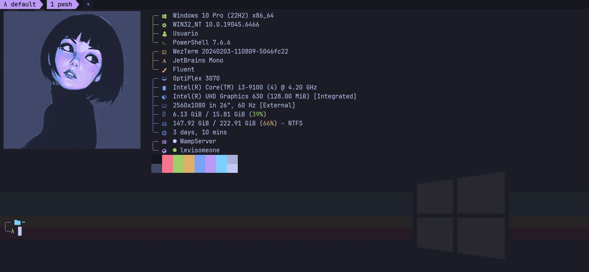

<h1 align="center">λ meu terminal no Windows</h1>

<p align="center">
  Visual de Linux, Neovim para programar em C e Python, tudo no Windows, sem WSL e sem dor de cabeça.
</p>

<p align="center">
  
</p>

---

## Por que isso existe

Eu gosto muito do jeito que o terminal de quem usa Linux fica: prompt limpo, cores boas, um neofetch na abertura e um editor que faz tudo sem sair do teclado. Só que eu uso Windows, e não queria instalar um Linux inteiro só por estética.

Então montei esse setup: **WezTerm + PowerShell + Starship + fastfetch + Neovim (LazyVim)**, com a paleta **Tokyo Night** em tudo, para parecer uma coisa só. Eu programo em **C** e **Python**, então o Neovim já vem pronto para isso, com autocomplete, erros em tempo real, formatação ao salvar e um atalho para compilar e rodar.

Se você também quer deixar o terminal do Windows com cara de Linux, pode usar do jeito que está ou pegar só as partes que gostar.

## O que tem aqui

| Pasta | Para que serve |
|---|---|
| `wezterm/` | O terminal em si: tema, abas estilo powerline com relógio e bateria, painéis divididos e atalhos |
| `powershell/` | O perfil do PowerShell: ícones, sugestões, aliases e a tela de boas-vindas |
| `starship/` | O prompt de duas linhas com o `λ`, o git e a versão da linguagem |
| `fastfetch/` | As informações do PC, agrupadas por cor, e o status do WampServer e do meu site |
| `nvim/` | O Neovim com LSP, formatação, tela inicial própria e o comando `:Novo` |
| `assets/` | A imagem da abertura e o print do README |

## O que eu mais gosto nele

- **A abertura.** Toda vez que abro o terminal aparece a imagem com as informações do PC do lado. Dois indicadores mostram se o **WampServer** está ligado e se o meu **site na Vercel** está no ar (bolinha verde = online, branca = offline).
- **`:Novo` no Neovim.** Eu digito `:Novo c/ola main.c` e ele cria a pasta, abre o arquivo e já coloca um modelo com `main()`. Também funciona com `Espaço n n`, que pergunta a pasta e o arquivo.
- **`F5`.** Compila e roda o arquivo atual num painel embaixo, em C ou em Python.
- **Painéis.** Um atalho (`Alt+e`) monta o layout de programação com o Neovim já aberto, sem eu precisar dividir a tela na mão.

## Como instalar

Preciso avisar: foi feito no **Windows 10/11 com PowerShell 7**. Em outros sistemas, talvez precise adaptar.

**1. Instale os programas** (uma vez só, no PowerShell):

```powershell
winget install wez.wezterm Microsoft.PowerShell Neovim.Neovim Git.Git Starship.Starship Fastfetch-cli.Fastfetch BurntSushi.ripgrep.MSVC Python.Python.3.12 OpenJS.NodeJS.LTS MSYS2.MSYS2
```

O compilador `gcc` vem do MSYS2 (pacote `mingw-w64-x86_64-toolchain`) e precisa estar no `PATH`. O Node é usado pelo Mason para instalar alguns servidores de linguagem.

**2. Base do Neovim**, se você ainda não tem o LazyVim:

```powershell
git clone https://github.com/LazyVim/starter $env:LOCALAPPDATA\nvim
Remove-Item $env:LOCALAPPDATA\nvim\.git -Recurse -Force
```

**3. Clone este repositório e rode o instalador:**

```powershell
git clone https://github.com/SEU_USUARIO/NOME_DO_REPO.git
cd NOME_DO_REPO
Install-Module Terminal-Icons -Scope CurrentUser -Force
.\install.ps1
```

O script copia cada arquivo para o lugar certo e **guarda uma cópia do que você já tinha** em `~\.config-backup-<data>`, então dá para voltar atrás. Se o PowerShell bloquear a execução, rode antes `Set-ExecutionPolicy -Scope CurrentUser RemoteSigned`.

Depois, feche e abra o WezTerm. Na primeira vez que abrir o `nvim`, ele baixa os plugins sozinho: espere terminar, feche e abra de novo.

## Atalhos que eu mais uso

**WezTerm**

| Atalho | O que faz |
|---|---|
| `Alt+d` / `Alt+s` | Divide a tela ao lado / embaixo |
| `Alt+setas` | Muda de painel |
| `Alt+r` + setas | Redimensiona o painel (`Esc` sai) |
| `Alt+z` | Zoom no painel |
| `Alt+t` | Nova aba |
| `Alt+n` / `Alt+p` | Próxima / anterior aba |
| `Alt+e` | Layout de programação com o nvim |

**Neovim**

| Atalho | O que faz |
|---|---|
| `Espaço` | Mostra o menu com todos os atalhos |
| `Espaço e` | Árvore de arquivos |
| `Espaço Espaço` | Procurar arquivo |
| `Espaço /` | Procurar texto no projeto |
| `Espaço c f` | Formatar (também formata ao salvar) |
| `gd` / `K` | Ir à definição / ver a documentação |
| `F5` | Compilar e rodar |

## Deixando do seu jeito

- **Cores:** a paleta fica no começo do `wezterm/.wezterm.lua` (a tabela `c`) e no `starship/starship.toml`. Trocar um valor muda tudo.
- **O que aparece na abertura:** cada linha do `fastfetch/config.jsonc` é uma informação. Apague a que não quiser.
- **Status dos serviços:** o `fastfetch/status.ps1` testa uma porta local ou um endereço. Troque a porta do Wamp e a URL do site no `config.jsonc`.
- **A imagem:** basta substituir o `assets/image_neofetchlike.png` mantendo o nome. O tamanho está em `ffimg`, no perfil do PowerShell.

## Coisas que você precisa saber

Fui descobrindo na prática e deixo aqui para poupar o seu tempo:

- **A imagem some** quando você redimensiona a janela ou sai do Neovim. É uma limitação do jeito que o Windows conversa com o terminal (ConPTY). O perfil recoloca a imagem sozinho ao fechar o nvim, e o comando `ff` redesenha tudo.
- **O `F5` em C usa o `gcc`.** Se só existir o `clang`, o Windows não acha o `stdio.h`, por falta das bibliotecas. Por isso uso o MSYS2.
- **Ícones quebrados?** Eles dependem de uma fonte Nerd Font. O WezTerm já traz uma embutida, mas, se aparecer algum quadradinho, instale a `JetBrainsMono Nerd Font`.

## Créditos

- Ilustração da abertura: *(coloque aqui o nome do artista e o link de onde pegou)*
- Ferramentas: [WezTerm](https://wezterm.org), [Neovim](https://neovim.io), [LazyVim](https://www.lazyvim.org), [Starship](https://starship.rs) e [fastfetch](https://github.com/fastfetch-cli/fastfetch)
- Paleta: [Tokyo Night](https://github.com/folke/tokyonight.nvim)

---

<p align="center">Se te ajudou, deixa uma ⭐ no repositório.</p>
